# Dashboard MEAL YMCA LAC

Dashboard regional del sistema MEAL (Monitoreo, Evaluación, Rendición de cuentas y Aprendizaje) de YMCA Latinoamérica y el Caribe. Es el **Producto 3: dashboards de monitoreo**.

> **Datos de demostración.** Las YMCA («YMCA Demo A–F») y todas las cifras de `data/` son ficticias. Sirven para probar el diseño y no son resultados de YMCA LAC.

- Dashboard publicado (Claude Artifacts, privado): https://claude.ai/artifact/K93wRCYcBYdMAByqCdEwq5
- Análisis, propuesta y decisiones: https://claude.ai/artifact/96bQGvVER99TTLyUK5U4Sy

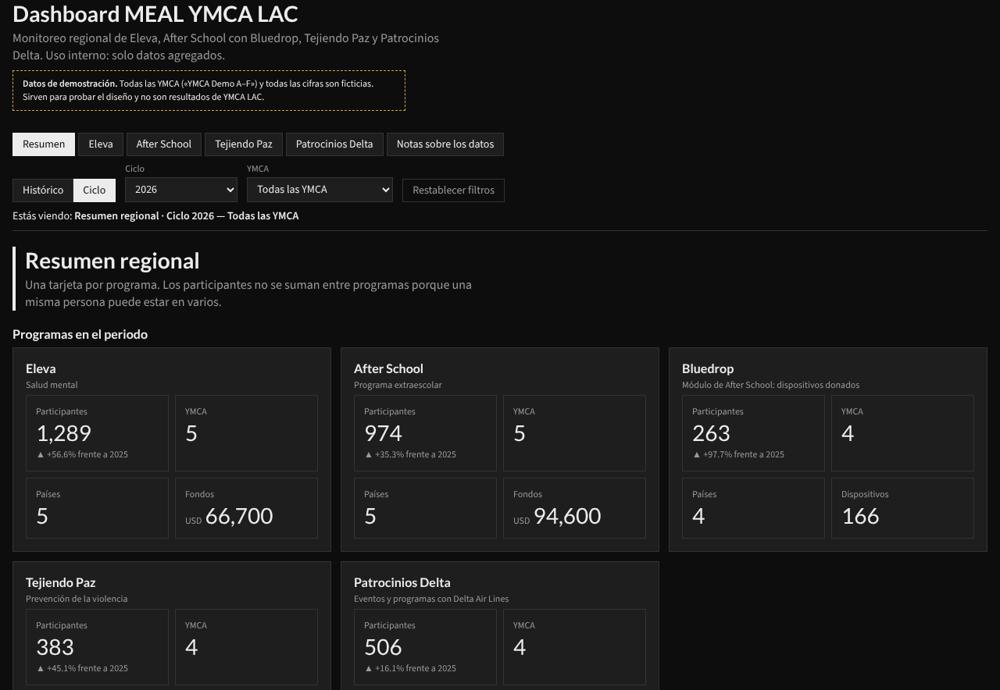

## Cómo se navega

Arriba hay una barra fija con el programa, la vista (Histórico o Ciclo), el ciclo y la YMCA. Debajo, la frase «Estás viendo» dice siempre qué se consulta, por ejemplo «Eleva · Ciclo 2026 — Todas las YMCA». Esa frase no está escrita a mano: se arma con los filtros en `dashboard/src/meal-draw.js`:

```js
dash.draw('contexto', (b) => {
  const k = keys();
  const prog = q().programa;
  const nombre = { resumen: 'Resumen regional', notas: 'Notas sobre los datos' }[prog] || PROG[prog] || '';
  b.textContent = `${nombre} · ${k.hist ? 'Histórico' : 'Ciclo ' + k.ciclo} — ${k.ymca === 'Todas' ? 'Todas las YMCA' : k.ymca}`;
});
```

Cada botón solo cambia un filtro con `dash.setParams`, y todos los dibujos se actualizan solos (`dashboard/src/meal-app.js`):

```js
all('.m-tab').forEach((b) => b.addEventListener('click', () => { dash.setParams({ programa: b.dataset.prog }); dash.setLink(b.dataset.prog); }));
all('.m-seg button').forEach((b) => b.addEventListener('click', () => dash.setParams({ vista: b.dataset.vista })));
```

Los valores iniciales de los filtros viven en `dashboard/store/dash/params.json`:

```json
{ "programa": "resumen", "vista": "ciclo", "ciclo": "2026", "ymca": "Todas", "astab": "programa" }
```

## El bloque común

Eleva, After School, Tejiendo Paz y Patrocinios Delta comparten el mismo bloque: participantes con variación frente al ciclo anterior, YMCA, países, fondos, mapa, pirámide de edad y género, dona de género y series por ciclo.

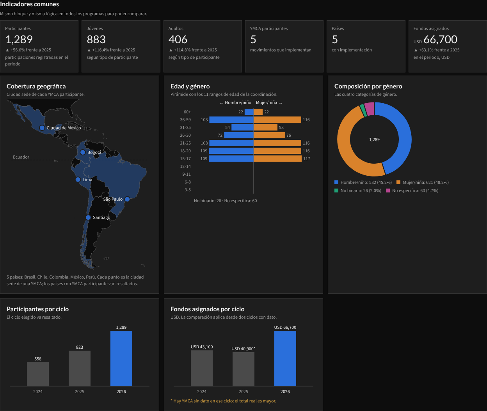

El bloque se genera con una sola función en `scripts/construir_pagina.py`, así que es idéntico en los cuatro programas. Para agregar una tarjeta a todos, se cambia aquí:

```python
def bloque_comun(prog, extra_kpis="", grupo_nota="participaciones registradas en el periodo"):
    """Bloque común obligatorio: igual en todos los programas."""
    kpis = (kpi(prog, "participantes", "Participantes", grupo_nota) + extra_kpis
            + kpi(prog, "ymca_participantes", "YMCA participantes", "movimientos que implementan", var=False)
            + kpi(prog, "paises", "Países", "con implementación", var=False)
            + kpi(prog, "fondos_usd", "Fondos asignados", "en el periodo, USD", fmt="usd"))
```

Eleva le suma jóvenes y adultos con `extra_kpis`:

```python
bloque_comun("eleva", kpi("eleva", "participantes_jovenes", "Jóvenes", "según tipo de participante")
                   + kpi("eleva", "participantes_adultos", "Adultos", "según tipo de participante"))
```

La variación es un cálculo visible para quien lee el dashboard (`dash.calc`), no un número guardado:

```js
const ok = r.estado === 'dato' && a && a.estado === 'dato' && Number(a.valor) > 0;
return { programa: r.programa, ciclo: r.ciclo, ymca: r.ymca, indicador: r.indicador, anterior,
  variacion_pct: ok ? Math.round(((Number(r.valor) - Number(a.valor)) / Number(a.valor)) * 1000) / 10 : null };
```

## Datos faltantes: nunca cero

Si una YMCA no reportó un valor, el dashboard dice «s/d» y avisa cuántas YMCA faltan en el total. En el Histórico, la gráfica marca con «*» los ciclos incompletos.

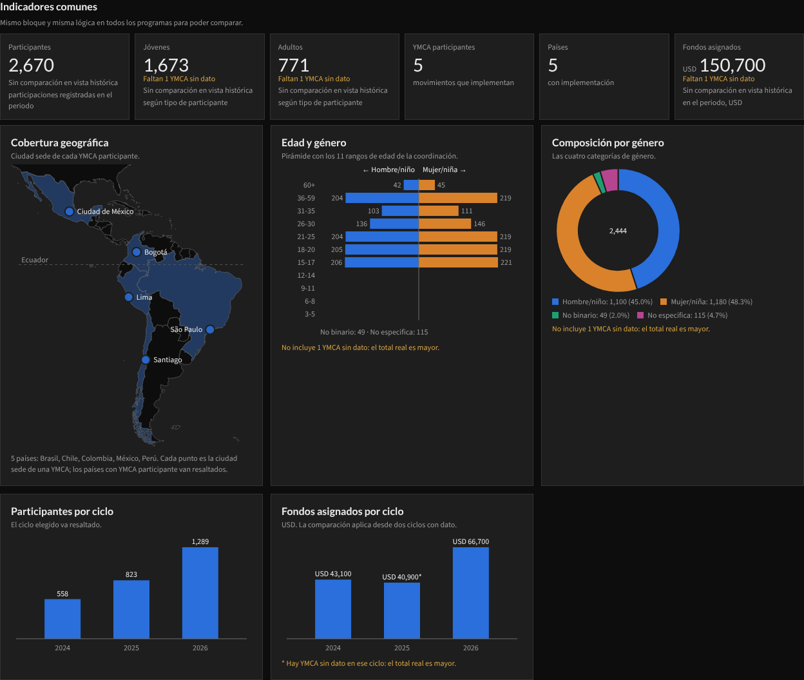

Así llega ese caso en `data/indicadores.json`: la fila de la YMCA tiene `valor: null` con su estado, y la fila precalculada «Todas» trae `faltantes`:

```json
{ "programa": "eleva", "ciclo": "2025", "ymca": "YMCA Demo D", "indicador": "participantes_jovenes", "valor": null, "estado": "sin_dato", "faltantes": 0 }
{ "programa": "eleva", "indicador": "participantes_jovenes", "ciclo": "2025", "ymca": "Todas", "valor": 408, "estado": "dato", "faltantes": 1 }
```

La tarjeta lee ese estado y nunca lo convierte en número (`dash.draw('kpi', …)` en `meal-draw.js`):

```js
const r = findInd(data, p, k, ind);
if (!r) { box.append(stateEl(implementa(p, k) ? 'sin_dato' : 'no_impl')); return; }
if (r.estado !== 'dato') { box.append(stateEl(r.estado)); return; }
```

Los estados posibles son `s/d`, `No recopilado`, `En definición`, `<5` y `No implementó`.

## Privacidad

En la vista por YMCA, los conteos de acompañamiento menores a 5 se muestran como «<5». El valor ni siquiera se guarda en los datos.

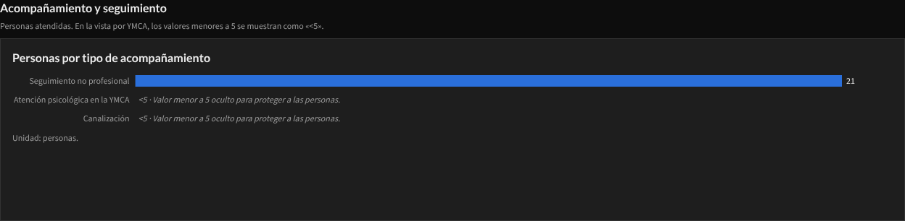

La regla está en `scripts/generar_datos_demo.py` y debe aplicarse igual cuando lleguen los datos reales:

```python
# Supresión de conteos pequeños en acompañamiento, solo en filas por YMCA (el valor no se guarda).
for r in cat_rows:
    if r["dimension"] == "acompanamiento" and r["valor"] is not None and r["valor"] < 5:
        r["valor"], r["estado"] = None, "suprimido"
```

En Tejiendo Paz, los grupos prioritarios se cuentan como número de YMCA, nunca de personas, y se ocultan al elegir una sola YMCA.

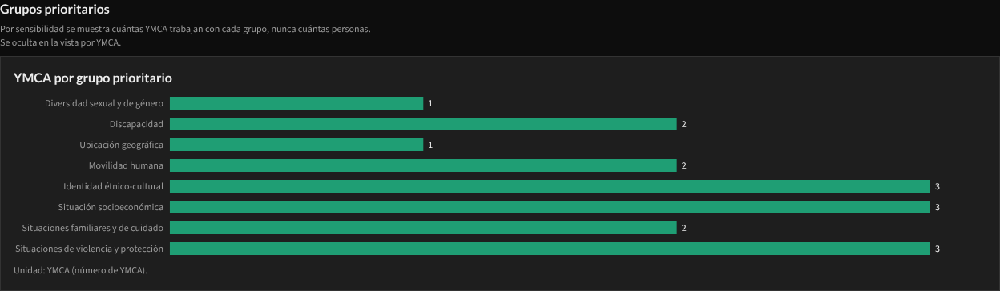

```html
<div class="m-chart" data-draw="barras" data-prog="tejiendo" data-source="categorias implementaciones" data-dim="grupos_prioritarios" data-orden="fijo" data-privado="1"></div>
```

## Módulos por programa

Eleva muestra el equipo, las intervenciones, el alcance comunitario, el cronograma de todas las YMCA juntas, las alianzas y las fichas de comunidad.

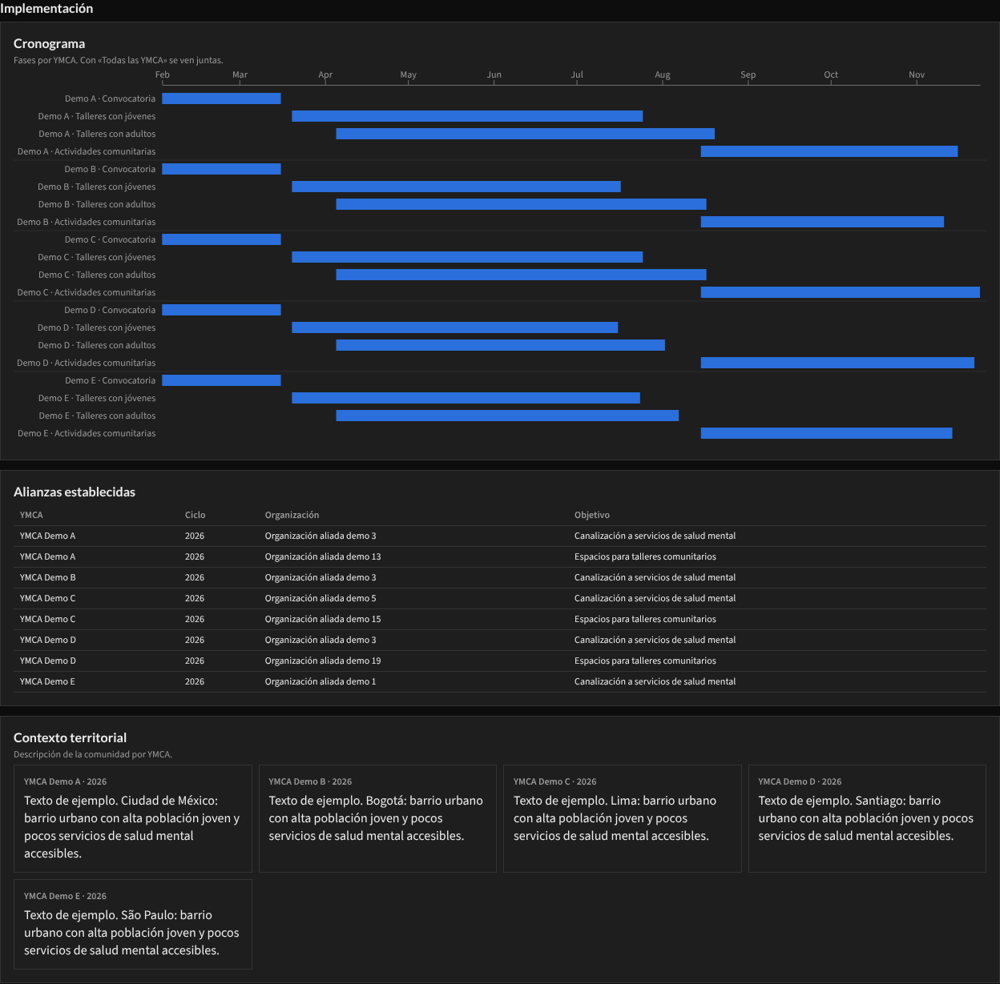

After School compara los terms de cada YMCA, los días de lunes a domingo, la modalidad y las áreas de intervención.

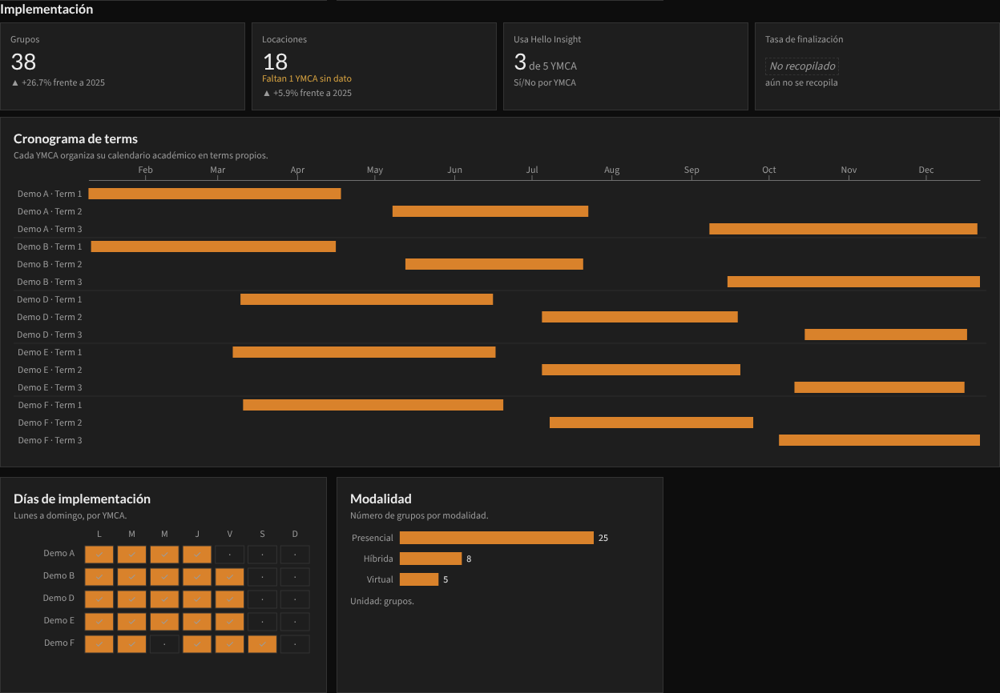

Bluedrop vive como pestaña dentro de After School, con sus dispositivos por tipo y modelo.

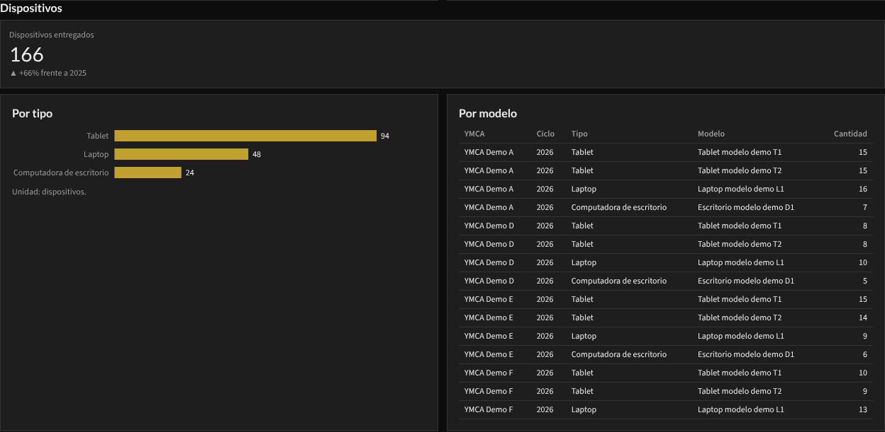

Patrocinios Delta muestra participantes y fondos por evento, el cronograma, el detalle y la narrativa.

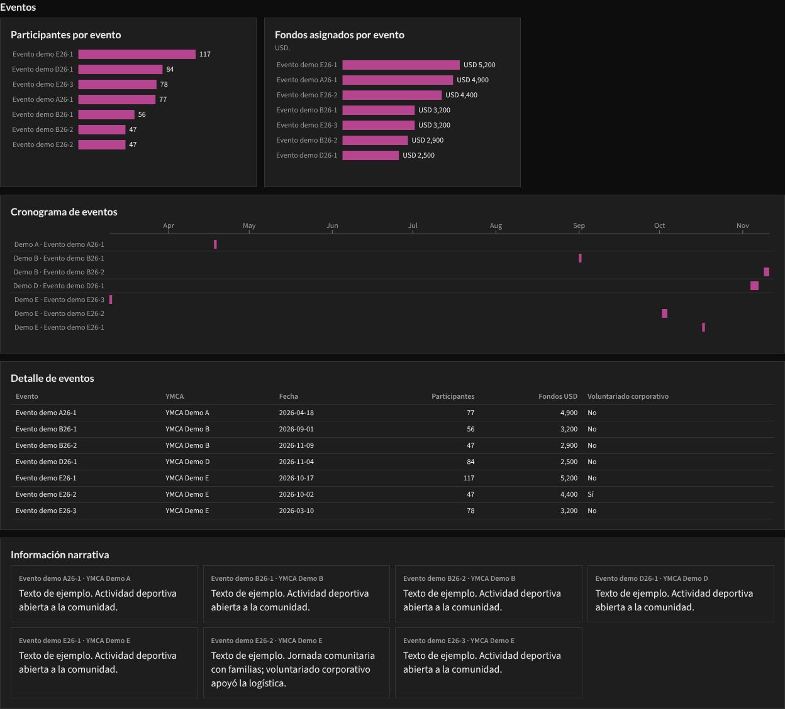

La página «Notas sobre los datos» explica los estados, los supuestos y cuántos valores faltan por programa y ciclo.

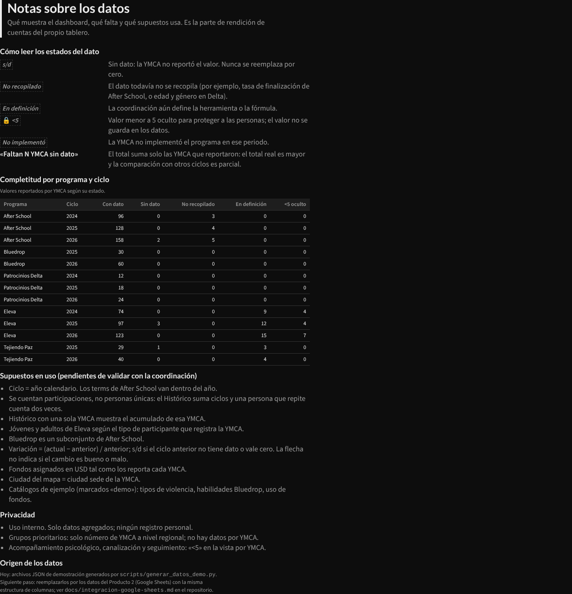

## En el celular

A 390 px todo pasa a una columna en el mismo orden de lectura y las tarjetas quedan de dos en dos.

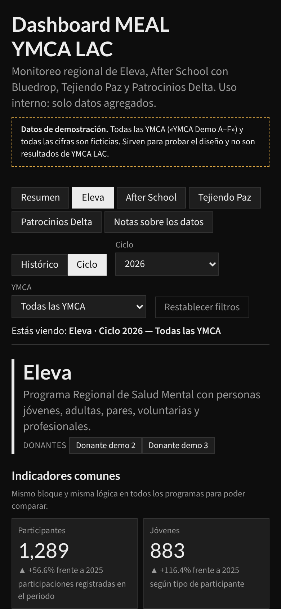

## Trazabilidad de cada cifra

Ninguna cifra está escrita en el HTML. Cada número se dibuja con su origen, y el panel *Sources* del dashboard lo muestra al hacer clic:

```js
const w = { programa: p, ciclo: k.ciclo, ymca: k.ymca, indicador: ind };
box.append(mark(el('span', null, fmt(r.valor)), 'indicadores', 'valor', w));
```

En la página queda así:

```html
<span data-source="indicadores" data-field="valor" data-where="programa=eleva&ciclo=2026&ymca=Todas&indicador=participantes">1,289</span>
```

## Cómo se usa el repositorio

Instalar las dependencias de prueba (d3 y Playwright):

```bash
npm install
```

Regenerar los datos de demostración en `data/` (semilla fija, siempre salen iguales):

```bash
npm run datos
```

Armar la página (`dashboard/dist/`) y los documentos que se escriben en el dashboard (`dashboard/store/`):

```bash
npm run build
```

Probar 84 combinaciones de filtros en 1280 px y 390 px. La prueba revisa que cada cifra coincida con su fila de datos, que no haya NaN ni desbordes y que no haya errores de JavaScript:

```bash
npm test
# ancho 1280: 84 escenarios, 0 con problemas
# ancho 390: 84 escenarios, 0 con problemas
```

Rehacer las capturas de este README (después de `npm test`):

```bash
node tests/capturas.js
```

Para publicar un cambio en el dashboard: subir cada `data/*.json` como archivo del artifact, pegar sus nuevas URL `/_blob/...` en `BLOBS` de `scripts/preparar_store.py`, correr `npm run build` y escribir `dashboard/store/` en el almacenamiento del dashboard.

## Dónde está cada cosa

- `data/`: datasets de demostración en JSON (tablas planas con `programa`, `ciclo`, `ymca` y `estado`).
- `dashboard/src/`: código fuente (`estilos.css`, `meal-core.js`, `meal-draw.js`, `meal-app.js`).
- `dashboard/dist/`: página armada tal como se publica.
- `dashboard/store/`: documentos del dashboard (`dash/meta`, `dash/params`, `datasets/*`, `files/*`).
- `scripts/`: generador de datos, armado de la página y del almacenamiento.
- `tests/`: prueba funcional y capturas.
- `docs/`: decisiones, fases e integración futura con Google Sheets.

El trabajo pendiente está en los [issues abiertos](https://github.com/diegoanahuac/Dashboard_YMCA/issues).
